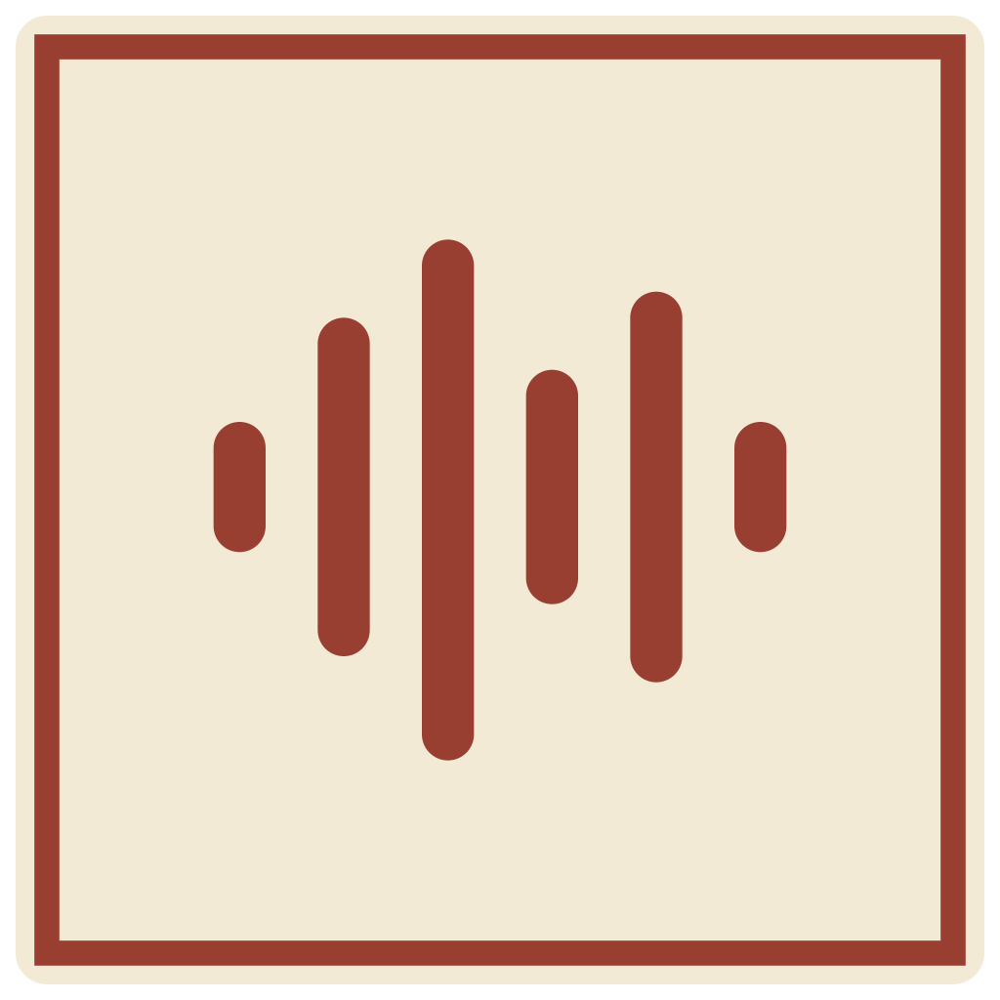

<div align="center">



# AskCue

**A desktop AI assistant for meetings, conversations, and interview practice.**

Live transcription. Contextual answers. Your choice of models.

[](package.json)
[](LICENSE)
[](#platforms)
[](https://buymeacoffee.com/ainur)

[Website](https://ainur-1.github.io/askcue/) · [Getting started](#getting-started) · [Features](#features) · [Development](#development) · [Issues](https://github.com/Ainur-1/askcue/issues)

</div>

AskCue brings a live transcript, AI assistance, and meeting history into one desktop workspace. Capture your microphone and system audio, ask questions about the conversation, and include screenshots when visual context matters. Connect your own AI providers, use OpenCode, or run a language model locally with Ollama.

**Project status:** `0.0.1` is the starting version of the independent AskCue fork. Expect changes to the interface, configuration, and packaging as the project develops. This version number does not imply that a downloadable release has been published.

## Features

| Capability | What you can do |
| --- | --- |
| Live transcription | Capture microphone and system audio separately and follow the conversation in real time. |
| Contextual AI actions | Draft a reply, ask a clarifying question, recap the conversation, brainstorm, or suggest follow-up questions. |
| Screenshot analysis | Add a full-screen or region capture to a request using a model that supports images. |
| OpenCode integration | Discover connected providers, search models, select a default, and stream responses through the official SDK. |
| Response timing | See elapsed response time, time to the first text, and completion or error status. |
| Meeting history | Store sessions locally, search transcripts, and use past meetings as context. |
| Transcript translation | Translate recognized speech with a separately configured language model. |
| Desktop workspace | Switch between workspace and compact overlay views, light and dark themes, and English or Russian interface text. |
| Diagnostics | Inspect AI action outcomes and timing in a local diagnostic log. |

Response quality and latency depend on your selected models, provider availability, network connection, and hardware.

## Getting started

### Install

Check [AskCue Releases](https://github.com/Ainur-1/askcue/releases) for published builds and platform-specific installation notes. If a suitable build is unavailable, follow the source setup below. Signing and notarization status depend on the individual build.

### Build from source

You will need:

- **Node.js 22** and **pnpm 11**, matching the build workflow.
- **Git** and the **Rust toolchain**.
- **Windows:** Visual Studio Build Tools with the Desktop development with C++ workload and a Windows SDK.
- **macOS:** Xcode Command Line Tools and a compatible macOS SDK.

```bash
git clone https://github.com/Ainur-1/askcue.git
cd askcue
pnpm install --frozen-lockfile
pnpm run build:native
pnpm run app:dev
```

Dependency installation downloads the bundled embedding model and rebuilds native database modules for Electron. The Rust audio module is built separately by `build:native`.

### Configure your first session

1. Open **Settings → AI Providers**, connect a provider, and select a model.
2. Configure a speech recognition provider and recognition language in Settings. Model access and speech recognition are separate services and may require separate credentials.
3. Select your microphone and audio capture settings. Grant the microphone and screen or system audio permissions requested by your operating system.
4. Start a meeting, check that the transcript is arriving, and use the AI actions or chat to work with the conversation.

For screenshot requests, choose a model with image support. If a provider rejects a request, check its credentials, available quota, and the error shown in AskCue.

### Use OpenCode

In **Settings → AI Providers → OpenCode**, use an existing connection or save your Go/Zen API token, refresh the model list, and choose a default. AskCue uses the official OpenCode SDK and CLI for provider discovery and inference.

See [OpenCode integration](docs/OPENCODE.md) for configuration, model selection, and connection behavior.

## Providers

| Purpose | Supported integrations |
| --- | --- |
| Language models | OpenCode, OpenAI, Anthropic Claude, Google Gemini, Groq, Ollama, and custom OpenAI-compatible endpoints |
| Speech recognition | Google Cloud Speech, Deepgram, Soniox, OpenAI, Groq, ElevenLabs, Azure Speech, and IBM Watson |

Available models and features depend on the connected provider and your account. AskCue does not include third-party subscriptions, API credits, or model access.

Ollama can run language model inference on your machine. The bundled speech recognition integrations use cloud services; choosing a local language model alone does not make the entire transcription pipeline offline.

## Data and privacy

Meeting records are stored in a local SQLite database. Requests to cloud speech providers transmit audio; requests to cloud language models transmit the context needed for the selected action, which can include transcript text, screenshots, or retrieved material. The selected provider's data policies apply to those requests.

**Credentials are currently stored in a local plaintext `credentials.json` file.** They are not protected by an OS keychain in this version. Treat the configuration directory as sensitive and exclude it from shared backups, bug reports, and source control. OpenCode also manages its own provider authentication.

| Data | Windows | macOS |
| --- | --- | --- |
| Configuration and credentials | `%APPDATA%\askcue\` | `~/.config/askcue/` |
| Meeting database and app data | `%APPDATA%\askcue\` | `~/Library/Application Support/askcue/` |

The AI action diagnostic log records request metadata, timing, and outcomes without transcript text or API tokens. Open it from **Settings → General → Open AI action log**. Other application logs may contain additional context; review them before sharing. See [AI action diagnostics](docs/AI_ACTION_DIAGNOSTICS.md).

Use recording, transcription, and AI assistance with the consent and permissions appropriate to your conversation.

## Platforms

- **Windows:** the current development and validation environment; native audio capture uses WASAPI.
- **macOS:** native capture and packaging code are included. Builds require validation on the target hardware; the default packaging configuration targets Apple Silicon.
- **Linux:** packaging configuration exists, but end-to-end audio capture and application support are not validated for this version.

An overlay content-protection setting is available. Its behavior depends on the operating system and capture software; do not assume it hides a window from every recording or screen-sharing tool.

## Development

| Command | Purpose |
| --- | --- |
| `pnpm run app:dev` | Start Vite and Electron for development |
| `pnpm run verify` | Check branding, lint the source, and run the test suite |
| `pnpm run build:web:raw` | Compile the renderer without running the full verification suite |
| `pnpm run build:electron:raw` | Compile the Electron main process and preload bridge |
| `pnpm run test:ui` | Check the built interface with test fixtures |
| `pnpm run test:opencode` | Check the bundled OpenCode lifecycle after compiling Electron |
| `pnpm run dist` | Verify, compile, and package the app into `release/` |

Build both the renderer and Electron code before running the interface checks. macOS packaging currently includes signing and notarization settings inherited from upstream; adapt these to your own signing identity before distributing a macOS build.

### Repository layout

```text
electron/       Desktop lifecycle, IPC, AI providers, audio services, and storage
src/            React interface, meeting workspace, settings, and localization
native-module/  Rust native audio capture module
shared/         Shared branding and OpenCode types
test/           Unit and integration tests
scripts/        Build, packaging, and verification tools
docs/           Integration notes and implementation documentation
demo/           Remotion demo source
```

The interface uses React, TypeScript, Vite, and Tailwind CSS. Electron owns desktop integration and provider access. Rust handles native audio capture; SQLite and `sqlite-vec` provide local persistence and vector search.

## Contributing

Bug reports, documentation improvements, and focused pull requests are welcome. Search [existing issues](https://github.com/Ainur-1/askcue/issues) before opening a report, and include your operating system, AskCue version, reproduction steps, and redacted diagnostic details.

Read [CONTRIBUTING.md](CONTRIBUTING.md) for the development workflow and [CODE_OF_CONDUCT.md](CODE_OF_CONDUCT.md) for community expectations. Report security concerns according to [SECURITY.md](SECURITY.md).

## Support

If AskCue is useful to you, you can [buy the maintainer a coffee](https://buymeacoffee.com/ainur) to support continued development. Thank you!

## Acknowledgments and license

AskCue is an independently maintained fork of [the original project by royisme](https://github.com/royisme/pikabaka). The upstream project and its contributors provided the foundation for this application. AskCue adds its own interface, localization, OpenCode integration, AI action diagnostics, and response timing.

The project is distributed under the [MIT License](LICENSE). Third-party components retain their respective licenses; see [the icon attribution](assets/ICON-LICENSE.txt) for the logo's source artwork.
